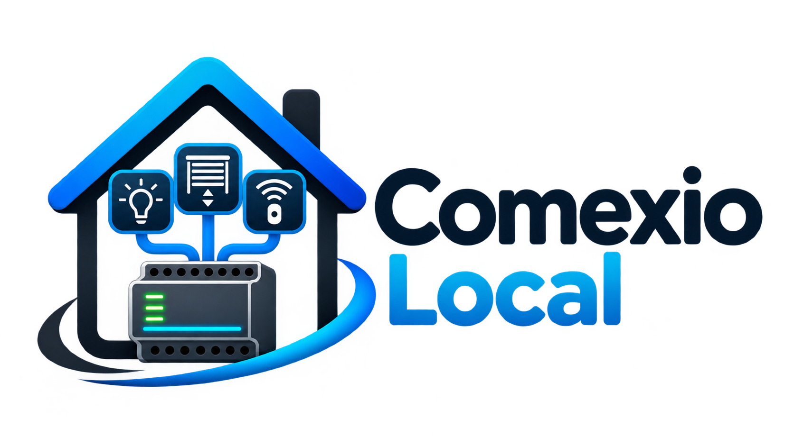

# COMEXIO Local

**Dein COMEXIO IO-Server in Home Assistant – lokal, ohne Cloud und ohne ständige Statusabfragen.**

COMEXIO Local erkennt die vom IO-Server bereitgestellten Geräte und Kanäle. Zustandsänderungen können über lokale Webhooks direkt in Home Assistant ankommen. Bestehende COMEXIO-Steuerungen bleiben erhalten.

**Aktuelle Version:** 0.4.5

> **Status:** Unabhängiges Community-Projekt in aktiver Entwicklung. Neue Funktionen zunächst kontrolliert testen.

## Was kann COMEXIO Local?

| Bereich | Funktionen |
| --- | --- |
| **Licht & Ausgänge** | Relais erkennen, schalten und Zustände per Push zurückmelden |
| **Rollläden** | Öffnen, schließen und Positionen steuern – mit vorhandenen Soll-/Ist-Merkern |
| **EnOcean & Eingänge** | Taster, Türkontakte, Bewegungs- und Präsenzsensoren einbinden |
| **Geräte & Bereiche** | Physische COMEXIO-Erweiterungen zuordnen, Bereiche und Namen verwalten |
| **Diagnose & Wartung** | Push-Verbindungen prüfen, gezielt reparieren und Änderungen synchronisieren |

**Wichtig:** Die Integration verändert beim Installieren keine COMEXIO-Logikpläne. Push-Verbindungen werden erst nach ausdrücklicher Bestätigung eingerichtet.

## Schnellstart

1. Unter **Einstellungen → Marketplace** das Repository [`CrashND/comexio-local`](https://github.com/CrashND/comexio-local) als benutzerdefiniertes **Integrations-Repository** hinzufügen (bei älteren Home-Assistant-Versionen über HACS).
2. **COMEXIO Local** installieren und Home Assistant neu starten.
3. Unter **Einstellungen → Geräte & Dienste → Integration hinzufügen** COMEXIO Local auswählen und den IO-Server verbinden.

Danach kannst du unter **COMEXIO Local → Konfigurieren** Geräte verwalten und passende Push-Verbindungen einrichten.

## Dokumentation

- **[Benutzerhandbuch](docs/benutzerhandbuch.md)** – Einrichtung, Licht, Rollläden, EnOcean und typische Bedienabläufe.
- **[Technische Dokumentation](docs/technik.md)** – Architektur, Webhooks, Ressourcenverwaltung und Sicherheitsmechanismen.
- **[Änderungsverlauf](CHANGELOG.md)** – Neuerungen und Fehlerbehebungen nach Version.

## Wichtige Hinweise

- **Rollläden** benötigen ein zusammengehöriges Positionsmerker-Paar `R_<Name>_soll` und `R_<Name>_ist`. Die Integration legt diese Merker nicht selbst an.
- **EnOcean-Sensoren** erscheinen am bestehenden Home-Assistant-Gerät „EnOcean“. Damit sie live aktualisieren, müssen ihre Push-Verbindungen eingerichtet sein.
- **Konfigurationsänderungen** am COMEXIO-Server werden nicht ungefragt übernommen. Für schreibende Push-Aufträge sind Vorschau und Bestätigung vorgesehen.
- **Doorstation** mit Kamera und Intercom ist in der aktuellen Version noch nicht integriert.

## Mitmachen & Kontakt

Fehler melden oder Ideen vorschlagen: **[GitHub Issues](https://github.com/CrashND/comexio-local/issues)**.

Entwicklung und Praxistests: **CrashND** · KI-gestützte Konzeption, Code und Dokumentation: **ChatGPT (OpenAI)**.

Die frühere [COMEXIO-Integration von kayl-codes](https://github.com/kayl-codes/homeassistant-comexio) diente als technische Referenz.

## Markenhinweis

**COMEXIO** ist eine Marke des jeweiligen Rechteinhabers. Die Rechte am Namen **COMEXIO** sowie an zugehörigen Marken- und Produktkennzeichen verbleiben beim Hersteller beziehungsweise den jeweiligen Rechteinhabern. Die Bezeichnung wird hier ausschließlich verwendet, um die Kompatibilität mit COMEXIO-Geräten zu beschreiben.

**COMEXIO Local** ist ein unabhängiges, inoffizielles Community-Projekt und steht in keiner geschäftlichen Verbindung zum Hersteller. Es wird weder vom Hersteller noch von Home Assistant offiziell entwickelt, unterstützt oder zertifiziert.
